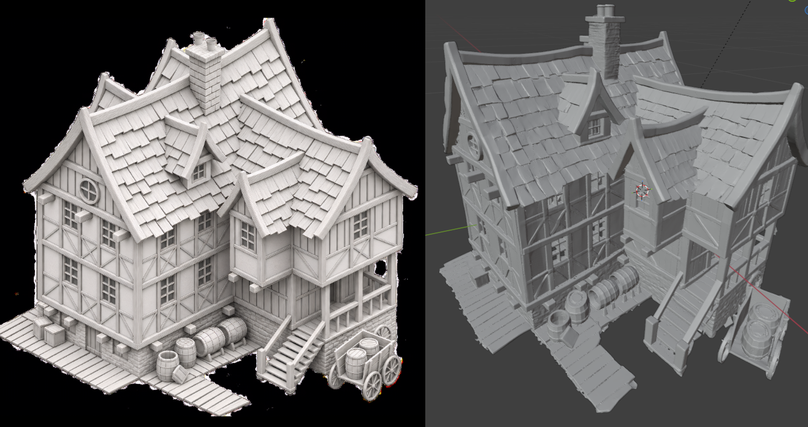

# Easymode's Ultra UniForge3D edition for COMFYUI, see workflow

Shout-outs to my boys PhantyForge, Ville, VisualBruno, MostAadTech Kvick, Agee and the rest of you too many to name!

Used in this workflow: [WTiVo-WatertightVoxel-ComfyuiNode](https://github.com/Mstafa-awad/WTiVo-WatertightVoxel-ComfyuiNode)




-- Original Readme below --

# UniForge3D: Joint 3D Reconstruction and Generation in a Shared Anchor-Guided Space

Wenjue Chen<sup>1,&#42;</sup>, Wenyue Chen<sup>1,2,&#42;</sup>, Heliang Zheng<sup>2</sup>, Rongfei Jia<sup>2</sup>, Yuan Liu<sup>3,&dagger;</sup>, Meng Li<sup>1,&dagger;</sup>

<sup>1</sup> Peking University &nbsp; <sup>2</sup> Math Magic &nbsp; <sup>3</sup> The Hong Kong University of Science and Technology

<sup>&#42;</sup> Equal contribution. <sup>&dagger;</sup> Corresponding authors.

[](https://xishuxishu.github.io/uniforge3d-project/)
[](https://huggingface.co/xibushu/UniForge3D)


UniForge3D generates complete 3D assets from sparse, unposed multi-view images. It jointly models reconstruction and generation in a shared anchor-guided space, then uses structure-guided view selection to preserve observed details. 

## Installation

```bash
git clone https://github.com/xibushu/UniForge3D.git
cd UniForge3D
bash setup.sh
conda activate uniforge3d
```

## Inference

Place the views of each object directly in a separate folder under `assets/`:

```text
assets/
├── case01/
│   ├── 001.png
│   ├── 002.png
│   ├── 003.png
│   └── 004.png
└── case02/
    └── ...
```

Run all cases using the pretrained model:

```bash
python infer.py
```


## Acknowledgements

Our code is based on these wonderful works:

- [TRELLIS.2](https://github.com/microsoft/TRELLIS.2)
- [VGGT](https://github.com/facebookresearch/vggt)

